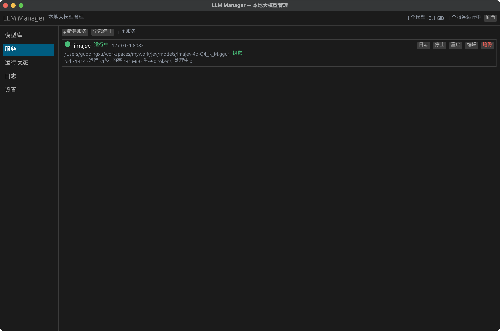
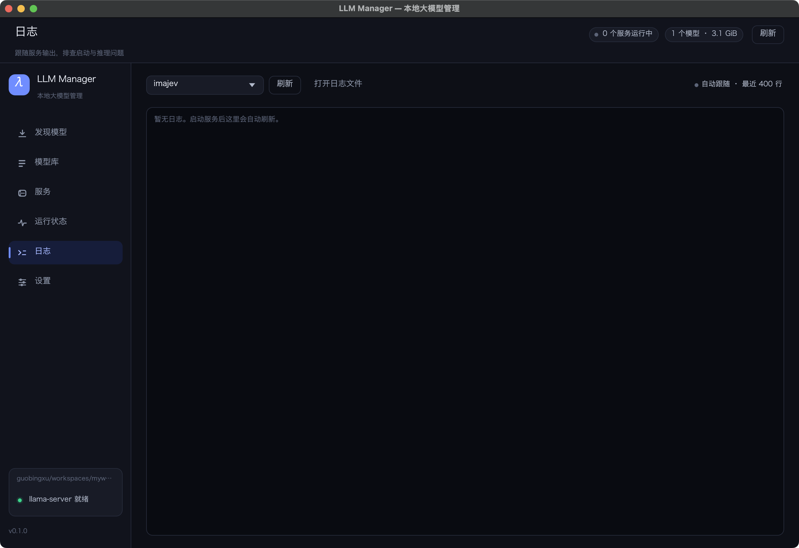
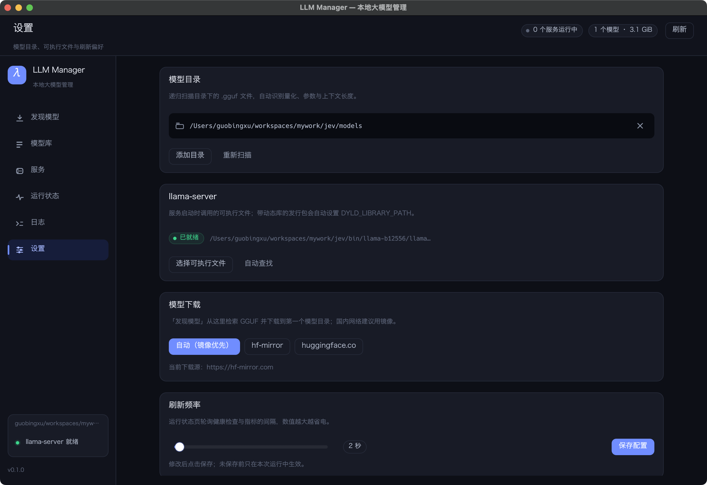

# LLM Manager

用 Rust 写的本地大模型（GGUF / llama.cpp）管理桌面端：扫描模型、启动/停止推理服务、看运行状态、翻日志、删文件。

界面用 `egui`/`eframe` 直接画（没有 Electron、没有 webview、没有 JS 依赖），整个程序是一个约 5.6 MB 的原生二进制，双击即可运行。


## 功能

**模型库**
- 递归扫描配置里的目录，识别 `.gguf`；自动跳过隐藏文件
- 解析 GGUF 头部：架构、**精确参数量**、量化类型、上下文长度、层数、嵌入维度
- 多分片模型（`xxx-00001-of-00003.gguf`）自动合并成一条，显示总大小，删除时整组删除
- `mmproj-*.gguf` 视觉塔自动配对到同名前缀的模型，服务里按需加载
- 路径、文件名、张量数、修改时间放在悬停提示里
- 启动（一键为该模型建服务）、在访达中显示、删除（默认移到废纸篓）

**服务**
- 新建 / 编辑 / 启动 / 停止 / 重启 / 删除
- 端口占用检测、模型文件缺失检测、重复启动保护
- 每个服务独立日志文件，退出后状态持久化（重启管理端会按 pid 校验实际存活）
- 自动为 llama.cpp 发行包设置 `DYLD_LIBRARY_PATH`（同一目录下有 `lib*.dylib` 时）



**运行状态**
- 每 N 秒轮询 `/health`、`/props`、`/metrics`，展示健康状态、已加载模型、上下文长度、并行槽、已生成/已处理 token 数
- 进程常驻内存（`proc_pidinfo`，不 fork `ps`）、运行时长、原始健康检查响应
- 机器维度：已用/总内存、磁盘剩余/总量


**日志**：选择服务后自动跟随 tail，一键在访达中定位日志文件。



**设置**：模型目录增删、`llama-server` 路径（手选或自动查找）、刷新间隔；配置/状态/日志路径一目了然。



## 快速开始

前置条件：macOS（Linux 亦可，RSS 回退到 `ps`）+ 一份 llama.cpp 发行包里的 `llama-server`。

项目自包含：`./.rust` 里放着编译用的 Rust 1.100 工具链，`./.cargo` 是 registry 缓存，删掉这两个目录也能用系统 cargo 重新编译。

```bash
cd ~/workspaces/mywork/llm-manager
./scripts/build.sh --release      # 编译（自动使用项目内 .rust 工具链）
./scripts/package.sh              # 打包成 dist/LLM Manager.app
open "dist/LLM Manager.app"
```

开发时直接 `./scripts/build.sh && ./target/debug/llmmgr`。

首次启动后到「设置」里确认 `llama-server` 路径、添加模型目录即可。

## 命令行

图形界面和 CLI 共用同一套后端与配置文件。

```bash
llmmgr                            # 打开图形界面
llmmgr list [过滤词]              # 列出模型
llmmgr services                   # 服务 + 运行状态
llmmgr new --name imajev --model ~/models/imajev-4b-Q4_K_M.gguf \
           --mmproj ~/models/imajev-4b-mmproj-f16.gguf --port 8080 --ctx 4096
llmmgr start imajev               # 等 /health 通过后返回
llmmgr stop imajev                # SIGTERM，10 秒不退再 SIGKILL
llmmgr restart imajev
llmmgr status [--json]            # 运行中服务的机器可读状态
llmmgr delete <路径|文件名> [--yes]   # 默认移到废纸篓
llmmgr add-dir <目录>
llmmgr set-server <llama-server 路径|auto>
llmmgr paths                      # 配置/状态/日志位置
```

## 配置文件

默认在 `~/Library/Application Support/llm-manager/`（Linux: `~/.local/share/llm-manager/`）：

| 文件 | 内容 |
| --- | --- |
| `config.json` | 模型目录、`llama-server` 路径、服务定义、刷新间隔 |
| `state.json` | 运行中服务的 pid / 启动时间 / 端口 / 日志路径 |
| `logs/<服务id>.log` | 每个服务独立的 stdout+stderr |

环境变量：`LLMMGR_HOME` 覆盖配置目录，`LLAMA_SERVER` 覆盖可执行文件路径。

## 生成的服务命令

```
llama-server --model <模型> --host 127.0.0.1 --port <端口> -c <ctx> -ngl 99 -np <并行>
             --jinja --no-webui --metrics
             [--mmproj <视觉塔> --image-min-tokens <n>]
```

## 代码结构

| 文件 | 职责 |
| --- | --- |
| `src/gguf.rs` | GGUF 头部/元数据/张量索引解析，量化类型推导 |
| `src/library.rs` | 目录扫描、分片合并、mmproj 配对、删除（废纸篓） |
| `src/config.rs` | 配置文件、服务定义、命令行拼装、`llama-server` 自动查找 |
| `src/runtime.rs` | 启停进程、pid/端口探测、HTTP 探测、RSS、系统内存/磁盘 |
| `src/ui.rs` | egui 五页界面、字体回退（中文）、轮询与动作派发 |
| `src/main.rs` | CLI 子命令与入口 |

## 说明与限制

- 只管理 GGUF + `llama-server`（llama.cpp）；vLLM、Ollama 等暂不支持
- 删除走 `~/.Trash`，重名自动加时间戳；不在废纸篓可用时直接删除
- 没有内置下载器：模型需自行放好（或用 `llmmgr add-dir` 指向已有目录）
- 服务是串行管理的（一个服务一条日志、一个端口），不做负载均衡
- `assets/icon-1024.png`、`assets/AppIcon.icns` 由脚本生成，可自行替换
- 仓库里不含编译产物：`target/`、`dist/`、`.rust/`、`.cargo/` 已在 `.gitignore` 中
