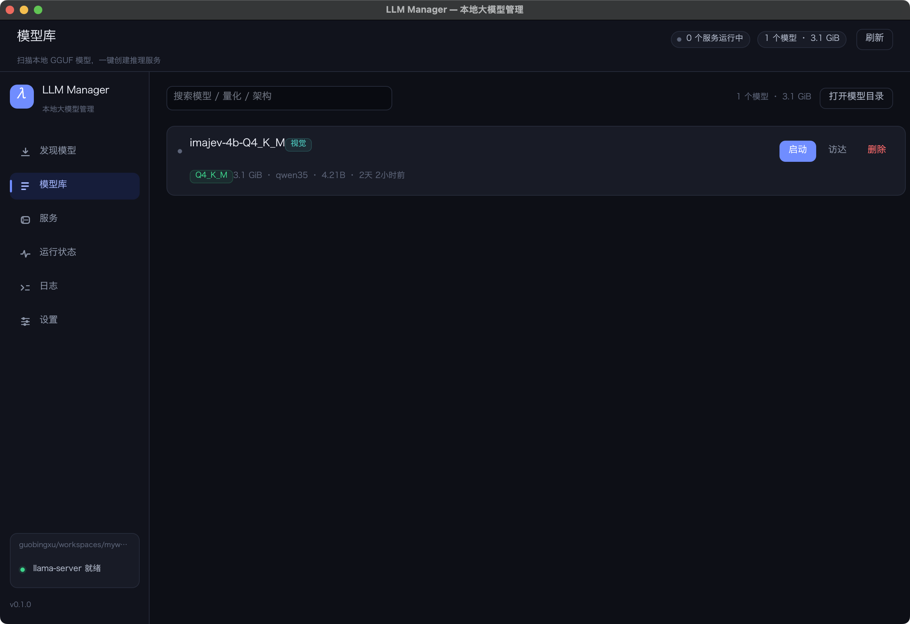
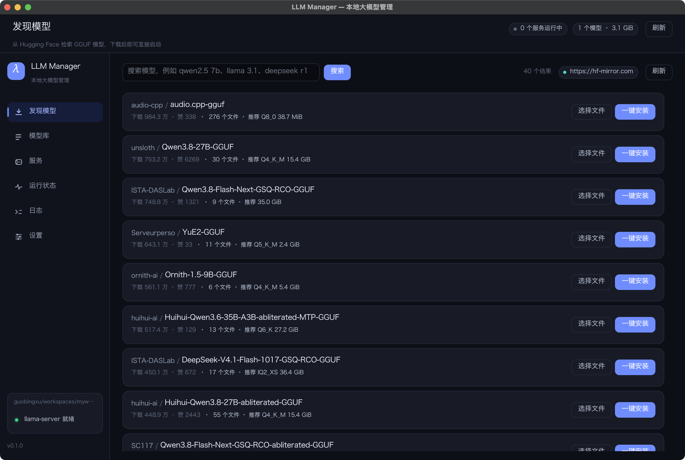
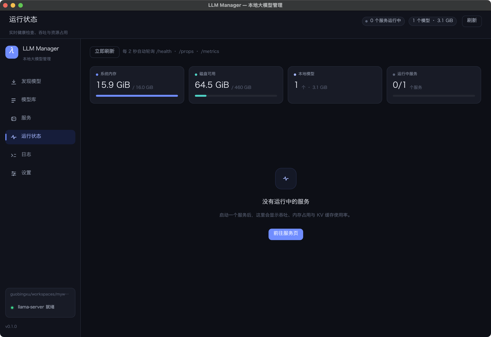

# LLM Manager

[](https://github.com/hellogbx/llm-manager/actions/workflows/ci.yml)
[](LICENSE)

用 Rust 写的本地大模型（GGUF / llama.cpp）管理桌面端：发现并下载模型、扫描本地模型、启动/停止推理服务、看运行状态、翻日志、删文件。

界面用 `egui`/`eframe` 直接画（没有 Electron、没有 webview、没有 JS 依赖），整个程序是一个约 6 MB 的原生二进制，双击即可运行。除 `llama-server` 和系统 `curl` 外没有外部依赖。



## 功能

**发现模型**
- 直接检索 Hugging Face 上的 GGUF 仓库（默认走 `hf-mirror.com` 镜像，可切回官方）
- 按下载量排序展示热门模型，支持关键词搜索
- 「一键安装」自动挑选推荐量化（`Q4_K_M` → `Q4_K_S` → `Q5_K_M` → `Q6_K` …），跳过视觉投影文件
- 列表直接标出「推荐量化的体积」（如 `30 个文件 · 推荐 Q4_K_M 15.4 GiB`），并在体积超出磁盘余量时标红「空间不足」
- 「选择文件」列出该仓库全部 `.gguf`（大小、量化、推荐标记、视觉投影标记、空间/内存是否够用），逐个下载
- 下载前先做本地条件检查：模型目录可写探测、磁盘余量（文件体积 + 10%，至少 64 MiB）、文件是否超出物理内存（给出提醒）
- 下载全程可见：进度、速度、剩余时间；中断后再次下载自动断点续传；可随时取消
- 完成后自动写进模型目录并重新扫描，直接就能建服务启动
- 底层用系统自带 `curl`，不引入额外依赖



**模型库**
- 递归扫描配置里的目录，识别 `.gguf`；自动跳过隐藏文件
- 解析 GGUF 头部：架构、**精确参数量**、量化类型、上下文长度、层数、嵌入维度
- 多分片模型（`xxx-00001-of-00003.gguf`）自动合并成一条，显示总大小，删除时整组删除
- `mmproj-*.gguf` 视觉塔自动配对到同名前缀的模型，服务里按需加载
- 路径、文件名、张量数、修改时间放在悬停提示里
- 启动（一键为该模型建服务）、在访达中显示、删除（默认移到废纸篓）

**服务**
- 新建 / 编辑 / 启动 / 停止 / 重启 / 删除
- 端口占用检测、模型文件缺失检测、重复启动保护
- 每个服务独立日志文件，退出后状态持久化（重启管理端会按 pid 校验实际存活）
- 自动为 llama.cpp 发行包设置 `DYLD_LIBRARY_PATH`（同一目录下有 `lib*.dylib` 时）


**运行状态**
- 每 N 秒轮询 `/health`、`/props`、`/metrics`，展示健康状态、已加载模型、上下文长度、并行槽、已生成/已处理 token 数
- 进程常驻内存（`proc_pidinfo`，不 fork `ps`）、运行时长、原始健康检查响应
- 机器维度：已用/总内存、磁盘剩余/总量



**日志**：选择服务后自动跟随 tail，一键在访达中定位日志文件。


**设置**：模型目录增删、`llama-server` 路径（手选或自动查找）、模型下载源（自动/镜像/官方）、刷新间隔；配置/状态/日志路径一目了然。


## 快速开始

前置条件：Rust（1.85+）、一份 llama.cpp 发行包里的 `llama-server`；macOS 为默认目标，Linux 也可编译（RSS 回退到 `ps`）。

```bash
git clone https://github.com/hellogbx/llm-manager.git
cd llm-manager
./scripts/build.sh --release      # 编译出 target/release/llmmgr
./scripts/package.sh              # 打包成 dist/LLM Manager.app（仅 macOS）
open "dist/LLM Manager.app"
```

开发时直接 `./scripts/build.sh && ./target/debug/llmmgr`；`cargo test` 可以跑单元测试。
如果仓库里带有 `./.rust`（项目内工具链）和 `./.cargo`（registry 缓存），`build.sh` 会自动使用它们；这两个目录不进 git，删掉后用系统 `cargo` 即可。

首次启动后到「设置」里确认 `llama-server` 路径、添加模型目录即可。

## 怎么用

装好之后按下面三步走：**配置 llama-server → 拿到模型 → 启动服务**。

### 1. 配置 llama-server

「设置 → llama-server」里点「自动查找」，或者手动选一个 `llama-server` 可执行文件。它来自 [llama.cpp](https://github.com/ggml-org/llama.cpp) 的发行包（macOS 常见是 `llama-b****/llama-server`）。状态变成绿色「已就绪」即可。

同一个目录下的 `lib*.dylib` 会自动加进 `DYLD_LIBRARY_PATH`，所以不用自己配动态库路径。

### 2. 拿到模型（两条路，任选）

- **在线下载**：左侧「发现模型」→ 搜 `qwen3` / `llama` / `deepseek` 之类的关键词 → 找一行顺眼的点「一键安装」（自动选推荐量化，比如 `Q4_K_M`）；想要别的量化就点「选择文件」自己挑。列表里的 `推荐 Q4_K_M 15.4 GiB` 就是会下载的体积，装之前会检查磁盘剩余空间和内存是否够。
- **本地已有**：「设置 → 模型目录」把放 `.gguf` 的文件夹加进来，「模型库」会自动扫描出来（多分片、`mmproj` 视觉塔都会自动识别合并）。

### 3. 启动服务

「模型库」里点某个模型的「启动」，会按默认参数（`ctx` 取模型声明的上下文，最多 8192；`-ngl 99` 全量上 GPU；并行 1）建一个服务并拉起 `llama-server`。想改端口、上下文、并行数、额外参数，就到「服务」里点「编辑」。

跑起来之后：

- 「运行状态」看健康检查、上下文、并行槽、已生成/已处理 token、进程内存、KV 缓存占用
- 「日志」跟着 `llama-server` 的输出，ERROR/WARN 会标色
- 服务卡片上的「访达」直接定位模型文件，「日志」跳到日志页

服务默认监听 `127.0.0.1:<端口>`，可以直接 `curl http://127.0.0.1:8080/v1/chat/completions` 用，也可以接到任何 OpenAI 兼容的客户端里。

### 一次完整的 CLI 示例

```bash
llmmgr fetch unsloth/Qwen3.8-27B-GGUF          # 下载推荐量化到第一个模型目录
llmmgr list                                     # 确认扫到了
llmmgr new --name qwen3 --model ~/models/xxx.gguf --port 8080 --ctx 8192
llmmgr start qwen3                              # 等 /health 通过后返回
llmmgr status                                   # 看运行状态
llmmgr stop qwen3
```

## 命令行

图形界面和 CLI 共用同一套后端与配置文件。

```bash
llmmgr                            # 打开图形界面
llmmgr list [过滤词]              # 列出模型
llmmgr services                   # 服务 + 运行状态
llmmgr new --name imajev --model ~/models/imajev-4b-Q4_K_M.gguf \
           --mmproj ~/models/imajev-4b-mmproj-f16.gguf --port 8080 --ctx 4096
llmmgr start imajev               # 等 /health 通过后返回
llmmgr stop imajev                # SIGTERM，10 秒不退再 SIGKILL
llmmgr restart imajev
llmmgr status [--json]            # 运行中服务的机器可读状态
llmmgr delete <路径|文件名> [--yes]   # 默认移到废纸篓
llmmgr add-dir <目录>
llmmgr fetch <仓库> [文件名] [--dir 目录]  # 从 Hugging Face 下载 GGUF（缺省选推荐量化）
llmmgr set-server <llama-server 路径|auto>
llmmgr paths                      # 配置/状态/日志位置
```

## 配置文件

默认在 `~/Library/Application Support/llm-manager/`（Linux: `~/.local/share/llm-manager/`）：

| 文件 | 内容 |
| --- | --- |
| `config.json` | 模型目录、`llama-server` 路径、服务定义、刷新间隔、下载源 `hub_endpoint` |
| `state.json` | 运行中服务的 pid / 启动时间 / 端口 / 日志路径 |
| `logs/<服务id>.log` | 每个服务独立的 stdout+stderr |

环境变量：`LLMMGR_HOME` 覆盖配置目录，`LLAMA_SERVER` 覆盖可执行文件路径。

## 生成的服务命令

```
llama-server --model <模型> --host 127.0.0.1 --port <端口> -c <ctx> -ngl 99 -np <并行>
             --jinja --no-webui --metrics
             [--mmproj <视觉塔> --image-min-tokens <n>]
```

## 代码结构

| 文件 | 职责 |
| --- | --- |
| `src/gguf.rs` | GGUF 头部/元数据/张量索引解析，量化类型推导 |
| `src/library.rs` | 目录扫描、分片合并、mmproj 配对、删除（废纸篓） |
| `src/config.rs` | 配置文件、服务定义、命令行拼装、`llama-server` 自动查找 |
| `src/runtime.rs` | 启停进程、pid/端口探测、HTTP 探测、RSS、系统内存/磁盘 |
| `src/hub.rs` | Hugging Face 检索、文件清单解析、curl 下载与断点续传 |
| `src/ui.rs` | egui 六页界面、字体回退（中文）、轮询与动作派发 |
| `src/main.rs` | CLI 子命令与入口 |

## 说明与限制

- 只管理 GGUF + `llama-server`（llama.cpp）；vLLM、Ollama 等暂不支持
- 删除走 `~/.Trash`，重名自动加时间戳；不在废纸篓可用时直接删除
- 下载器依赖系统 `curl`；需要 gated 授权的仓库、HF token 认证暂不支持
- 下载文件只校验大小，不校验 sha256；代理可用 `HTTPS_PROXY` 交给 curl 处理
- 服务是串行管理的（一个服务一条日志、一个端口），不做负载均衡
- `assets/icon-1024.png`、`assets/AppIcon.icns` 由脚本生成，可自行替换
- 仓库里不含编译产物：`target/`、`dist/`、`.rust/`、`.cargo/` 已在 `.gitignore` 中

## 协议

[MIT](LICENSE) © 2026 hellogbx
